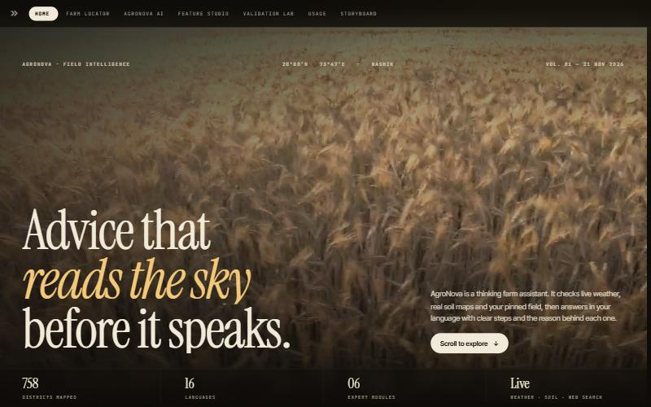
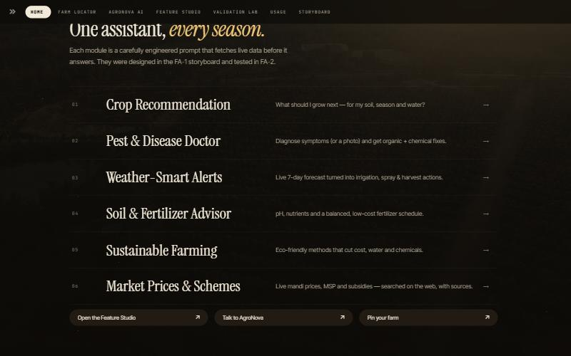
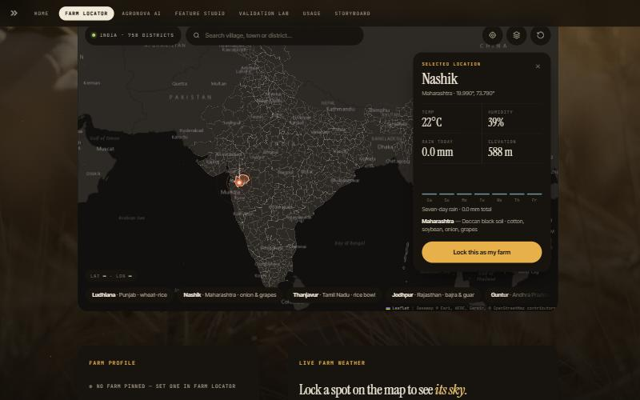
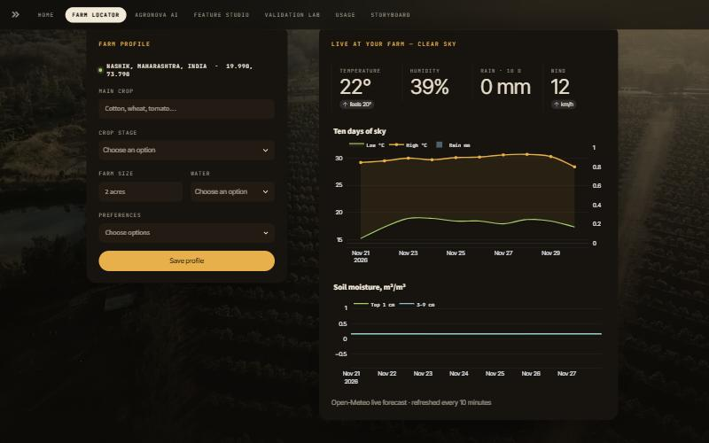
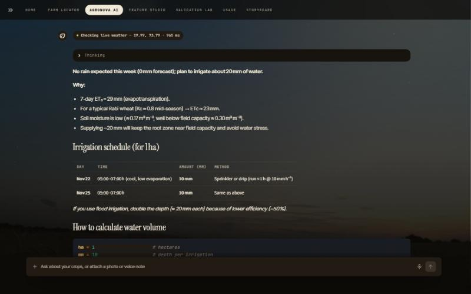
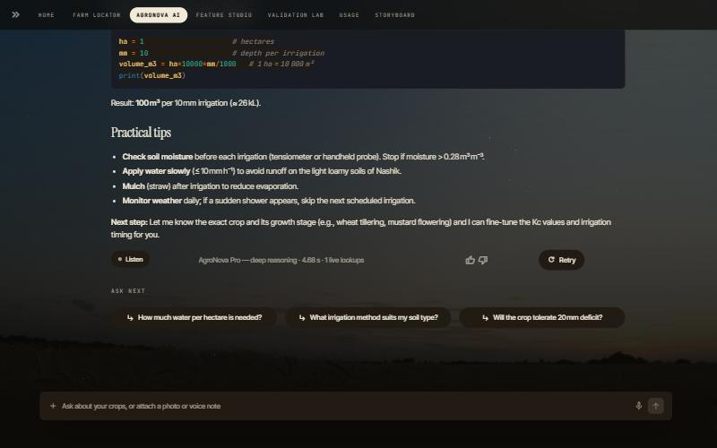

<div align="center">



<a href="https://agronova-genai-fa.streamlit.app">
  
</a>

<p>
  <a href="https://agronova-genai-fa.streamlit.app"></a>
</p>

<p>
  
  
  
  
  
  
</p>

🌐 Live app → https://genai-fa-kqthfygr5t4appvkkx546sz.streamlit.app/
</div>

---

## 🎬 A quick walk through

<div align="center">
  
  <br/><sub>Home · six AI modules · India map · live farm weather · AgroNova AI · read-aloud, sources and follow-ups · Feature Studio</sub>
</div>

---

## 🌾 What is AgroNova?

**AgroNova** is a **Smart Farming Assistant** built for the CRS *Generative AI* course, covering
**Formative Assessment 1** (ideation, prompt design, API planning) and **Formative Assessment 2** (web app, API
integration, validation, deployment). The scenario: the agri-tech startup **AgroNova** wants an assistant that gives
**real-time, region-specific, multilingual** farming advice to small and medium farmers in **India, Ghana and Canada**.
It supports **UN SDG 2 (Zero Hunger)** and **SDG 13 (Climate Action)**.

A farmer pins their field on the map, then asks a question by typing, sending a photo or recording a voice note.
AgroNova **thinks**, **fetches live data** (weather, soil, crop calendar, web), and answers in plain language with
**the reason behind every step**, the way a senior agronomist would.

> [!TIP]
> **The AI is built in.** Visitors never see or enter an API key: the app's own key lives in server-side secrets.

---

## ✨ Highlights

<table>
<tr>
<td width="50%" valign="top">

### 🧠 An AI that works like Claude
- **Streams** its answer as it writes
- Shows its **reasoning** in a "Thinking" panel
- **Calls tools on its own**: weather, soil, crop calendar, geocoding
- **Searches the web** for mandi prices, MSP and schemes, and lists its **sources**
- Runs **exact calculations** in a code sandbox
- **Remembers** the whole conversation
- Gives a one-line answer, then steps with a ***why*** each, then a table, safety notes and a next step

</td>
<td width="50%" valign="top">

### 🎙️ Multimodal & safe
- 📷 **Photo diagnosis**: switches to a vision model automatically
- 🎤 **Voice notes**: transcribed by Whisper
- 🔊 **Listen**: reads every answer aloud in your language
- 💬 **"Ask next"**: three follow-up suggestions after each answer
- 🛡️ **Safety guard**: Llama Prompt Guard blocks jailbreaks
- 🌍 **All 22 Indian scheduled languages** (Assamese, Bengali, Bodo, Dogri, Gujarati, Hindi, Kannada, Kashmiri, Konkani, Maithili, Malayalam, Manipuri, Marathi, Nepali, Odia, Punjabi, Sanskrit, Santali, Sindhi, Tamil, Telugu, Urdu) + Bhojpuri, Rajasthani, Haryanvi, Chhattisgarhi, Tulu, Khasi, Mizo, Hinglish + Swahili, Twi, French, Portuguese, Spanish, English. **Auto mode** replies in whatever language the farmer uses

</td>
</tr>
<tr>
<td width="50%" valign="top">

### 🗺️ Interactive India map
- **758 districts** (2011 census boundaries)
- Hover lights up the whole state; a label follows your cursor
- **Search any village**, use **GPS**, or tap a farming hub
- Smooth **fly-to** camera, pulsing pin, **satellite** toggle
- Live weather card → **"Lock this as my farm"** → every answer uses it

</td>
<td width="50%" valign="top">

### 🎨 Cinematic "Field Journal" design
- Warm, colour-graded **farm footage behind every page**
- **Three.js** dust motes drifting through sunlight, with film grain
- Editorial type: *Instrument Serif* + Inter Tight + JetBrains Mono
- Masked headline reveals, scroll-lit manifesto, cursor-following image previews
- Solid surfaces with no outlines; the assistant writes on the page like Claude

</td>
</tr>
</table>

---

## 🖼️ Screens

<table>
<tr>
<td width="50%"><br/><sub><b>Home:</b> full-bleed wheat footage and an editorial hero</sub></td>
<td width="50%"><br/><sub><b>Six AI modules:</b> an editorial index with hover previews</sub></td>
</tr>
<tr>
<td width="50%"><br/><sub><b>Farm Locator:</b> 758 districts, live weather card, lock your farm</sub></td>
<td width="50%"><br/><sub><b>Live farm weather:</b> 10-day sky and soil moisture (Open-Meteo)</sub></td>
</tr>
<tr>
<td width="50%"><br/><sub><b>AgroNova AI:</b> live tool step, Thinking panel, structured answer</sub></td>
<td width="50%"><br/><sub><b>After each answer:</b> Listen, model, feedback, retry, "Ask next"</sub></td>
</tr>
</table>

---

## ⚙️ How it answers

<div align="center"></div>

<details>
<summary><b>Built-in AI capabilities, all on one Groq key</b></summary>

| Ability | Model / service | What the farmer sees |
|---|---|---|
| Reasoning chat + tools | `openai/gpt-oss-120b` · *AgroNova Pro* | Streamed answer, a "Thinking" panel and live step chips |
| Fast side-tasks | `openai/gpt-oss-20b` · *AgroNova Swift* | Follow-up suggestions and grading |
| Photo diagnosis | `qwen/qwen3.8-27b` · *AgroNova Vision* (picked automatically) | "Looking at your photo" |
| Web search + page reading | Groq built-in `browser_search` | "Searching the web — …", "Reading — site", then source cards |
| Exact calculations | Groq built-in `code_interpreter` | "Running a calculation", with precise doses, areas and revenue |
| Voice notes | `whisper-large-v3-turbo` | "Transcribing voice note" |
| Safety screening | `meta-llama/llama-prompt-guard-2-86m` | Jailbreak / prompt-injection attempts get a polite refusal |
| Weather & soil moisture | Open-Meteo (no key) | "Checking live weather" |
| Soil properties | ISRIC SoilGrids (no key) | "Reading soil profile" |
| Read aloud | Browser speech synthesis | A **Listen** button on every answer |

The engine (`agronova/llm.py`) speaks the OpenAI-compatible protocol and picks the provider from the key: **Groq**
(`gsk_…`) or **xAI Grok** (`xai-…`). If a model can't handle images, tools or usage streaming, it falls back automatically.
</details>

---

## 🧭 Pages

| | Page | What it does |
|---|---|---|
| 🏠 | **Home** | Cinematic hero, gold ticker, scroll-lit manifesto, editorial module index, field footage, count-up stats |
| 🗺️ | **Farm Locator** | Interactive India map + farm profile (crop, stage, size, water, preferences) + 10-day weather and soil charts |
| 💬 | **AgroNova AI** | The chat agent: text, photo or voice in; streamed, sourced, reasoned answers out |
| 🌱 | **Feature Studio** | Six modules, each driven by an engineered prompt template that fetches live data first |
| 🔬 | **Validation Lab** | FA-2 Step 5: a regional test suite, AI-judge scoring, a radar chart, naive-vs-optimised prompt A/B, a reviewer checklist |
| 📊 | **Usage** | Monitoring: queries, latency, live lookups, 👍 rate, module mix, top farm locations, CSV export |
| 📘 | **Storyboard** | FA-1 deliverable: problem, research, personas, prompts, API parameters, code |

### The six modules (FA-1 core features + one)

| # | Module | Sample farmer prompt |
|---|---|---|
| 01 | 🌾 **Crop Recommendation** | *"Suggest crops to plant in July in Tamil Nadu."* |
| 02 | 🐛 **Pest & Disease Doctor** | *"White fungus on wheat leaves in Haryana — treatment?"* |
| 03 | ⛈️ **Weather-Smart Alerts** | *"Rain prediction and farming advice for Punjab this week?"* |
| 04 | 🧪 **Soil & Fertilizer Advisor** | *"What should I grow in slightly acidic soil in Kenya?"* |
| 05 | ♻️ **Sustainable Farming** | *"Give eco-friendly pest control methods for grapes in Italy."* |
| 06 | 📈 **Market Prices & Schemes** | *"What is the onion price at Lasalgaon mandi this week?"* |

---

## 🎓 Assessment coverage

<details open>
<summary><b>FA-1: Ideation, prompt design, API planning</b></summary>

- [x] **Problem statement** with India + global relevance (Storyboard → *Problem & research*)
- [x] **Five regional challenges** + research summary (FAO, World Bank, NABARD/NMSA, KVK)
- [x] **User personas**: Sunita (Nashik, Maharashtra) and Kwame (Kumasi, Ghana)
- [x] **Five core features** with 2–3 farmer prompts each and engineered prompt templates
- [x] **Working Python API integration** with `temperature` and `max_tokens` explained (Storyboard → *LLM API*)
- [x] UI flow: the app itself
</details>

<details open>
<summary><b>FA-2: Web app, integration, validation, deployment</b></summary>

- [x] **Step 4, output formatting & reasoning**: a one-line answer, bullets/tables, and a *why* for every suggestion
- [x] **Step 5, validation & optimisation**: 6 region-diverse prompts (India, Ghana, Canada, Kenya), keyword checks against expected agronomy, AI-judge scoring, a **naive vs optimised prompt A/B test**
- [x] **Feedback checklist**: regional, logical reasoning, simple language, not too generic or technical, safe
- [x] **Step 6, Streamlit app**: location, crop stage and preferences in; formatted AI suggestions out
- [x] `app.py` + `requirements.txt` in a public GitHub repo
- [x] **Deployed on Streamlit Cloud** → [agronova-genai-fa.streamlit.app](https://agronova-genai-fa.streamlit.app)
- [x] Responsive layout for cross-device testing; usage monitoring + 👍/👎 feedback
</details>

> [!NOTE]
> The brief names Gemini 1.5. AgroNova runs the same prompt engineering, parameters and tool use on **Groq's open
> models** through the OpenAI-compatible API. Only the client library differs, as the Storyboard explains.

---

## 🚀 Run it locally

```bash
git clone https://github.com/kavin-beep/GENAI-FA.git
cd GENAI-FA
pip install -r requirements.txt
```

Create `.streamlit/secrets.toml` (it's git-ignored) with a free key from [console.groq.com/keys](https://console.groq.com/keys):

```toml
GROQ_API_KEY = "gsk_..."
```

```bash
streamlit run app.py
```

## ☁️ Deploy on Streamlit Community Cloud

1. Go to **[share.streamlit.io](https://share.streamlit.io)** → **Create app** → repo `kavin-beep/GENAI-FA`, branch `main`, file **`app.py`**.
2. Set **App URL** to **`agronova-genai-fa`**, which gives `https://agronova-genai-fa.streamlit.app`.
3. **Advanced settings → Secrets** → `GROQ_API_KEY = "gsk_..."`.
4. **Deploy**, then test on a phone, a laptop and a second browser.

> [!IMPORTANT]
> Never commit your key. `.streamlit/secrets.toml` is in `.gitignore`. On the cloud the key lives in Streamlit's
> Secrets, so the AI stays built in and invisible to visitors.

---

## 🗂️ Project structure

```text
GENAI-FA/
├── app.py                      # entry point: page config, sidebar, top navigation
├── requirements.txt            # streamlit, openai, requests, pandas, plotly
├── agronova/
│   ├── llm.py                  # agent loop: streaming, reasoning, tools, web search, vision, Whisper, guard
│   ├── tools.py                # weather / soil / crop-calendar / geocoding tools
│   ├── prompts.py              # system prompt, 6 module templates, validation suite, checklist, judge
│   ├── views.py                # all seven pages
│   ├── theme.py                # Field Journal design system + motion layer (video, Three.js, reveals)
│   ├── state.py                # session state, built-in key, usage logging
│   └── map_component.py        # bi-directional Streamlit component wrapper
├── components/india_map/
│   ├── index.html              # Leaflet + custom-motion India district map (no build step)
│   └── india_districts.json    # 758 simplified district boundaries
├── .streamlit/config.toml      # dark warm theme
└── docs/media/                 # README banner, architecture diagram, screenshots, demo GIF
```

## 🧰 Tech stack

<p>
  
</p>

**Streamlit** · **Groq** (gpt-oss, Qwen, Whisper, Prompt Guard) · **OpenAI Python SDK** · **Leaflet** · **Three.js** ·
**Plotly** · **Pandas** · **Open-Meteo** · **ISRIC SoilGrids**

---

## 🙏 Credits

Weather and geocoding: [Open-Meteo](https://open-meteo.com) (CC-BY 4.0) · Soil: [ISRIC SoilGrids](https://soilgrids.org) (CC-BY 4.0) ·
District boundaries: `udit-001/india-maps-data` · Basemaps: Esri, © OpenStreetMap contributors · Footage: [Mixkit](https://mixkit.co) ·
Photos: [Unsplash](https://unsplash.com) · Models served by [Groq](https://groq.com).

AgroNova's advice is guidance, not a guarantee. Confirm big decisions with your local **Krishi Vigyan Kendra** or
extension officer (Kisan Call Centre **1800-180-1551**).

<div align="center">
  
</div>
